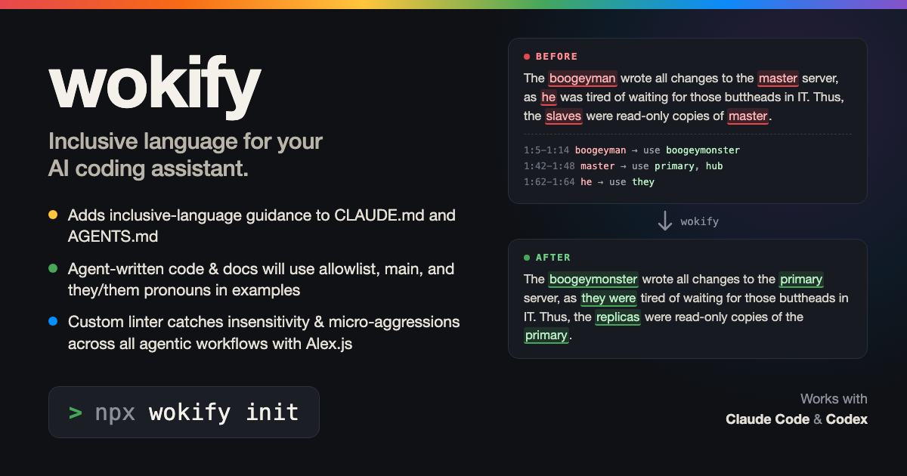

# wokify



Inclusive language for your AI coding assistant.

- Adds inclusive-language guidance to the files **Claude Code** (`CLAUDE.md`) and **Codex** (`AGENTS.md`) read at the start of every session.
- Agent-written code and docs use terms like `allowlist`, `primary / replica`, and `main`, and "they" for a generic person.
- A built-in [Alex.js](https://alexjs.com) linter catches insensitive and profane wording. In Claude Code it runs after every edit, so the agent fixes its own wording before you see it.

## Quick start

Run this in your project folder:

```bash
npx wokify init
```

That does three things:

1. Adds the guidelines to `CLAUDE.md` and `AGENTS.md`, creating them if needed.
2. Adds a Claude Code hook to `.claude/settings.json` that lints each file Claude edits.
3. Tells every agent, Codex included, to run `wokify lint` on the files it changes.

Commit those files so your whole team gets the same behavior.

To apply it to every project on your machine instead:

```bash
npx wokify init --global
```

That writes to `~/.claude/CLAUDE.md`, `~/.claude/settings.json`, and `~/.codex/AGENTS.md` (or `$CODEX_HOME/AGENTS.md`).

## The linter

```bash
npx wokify lint            # this folder
npx wokify lint docs src   # specific files or folders
```

```
docs/architecture.md
  3:5   `boogeyman` may be insensitive, use `boogeymonster` instead
  3:42  `master` may be insensitive, use `primary`, `lead`, `hub` instead
  3:62  `he` may be insensitive, use `they`, `it` instead

3 issues in 1 file (checked 12 files)
```

- It checks Markdown, HTML, plain text, and common source-code files. In a git repo it follows `.gitignore`.
- It exits with code 1 when it finds something, so you can use it in CI.
- It's powered by Alex.js, so `.alexrc` (or an `"alex"` field in `package.json`) works for allow lists and settings. wokify only flags profanity that's at least "maybe" offensive, so words like "kill" and "execute" in code don't get flagged.
- To keep a flagged word you can't change, such as a third-party API name, add a `wokify-ignore` comment on that line, or `wokify-ignore-next-line` on the line above.

### In Claude Code

The hook runs `wokify lint` after every `Write`, `Edit`, and `MultiEdit`, and only checks the lines Claude just wrote. Older text in the file that Claude didn't touch is never flagged. When it finds something, Claude sees the message and rewords it.

## What the guidelines say

They ask the assistant to:

- use inclusive terms by default in new code and text, without commenting on it
- leave existing public APIs, config keys, and outside names alone, so nothing breaks
- use "they" for a generic person
- run the linter on the files it changes

They come with a table of preferred terms. Run `npx wokify print` to see the full text, or read [RULES.md](RULES.md).

## Commands

| Command | What it does |
| --- | --- |
| `npx wokify init` | Adds the guidelines and the Claude Code hook, or updates them to the current version |
| `npx wokify lint [paths]` | Checks files for insensitive wording |
| `npx wokify uninstall` | Removes the guidelines and the hook, leaving everything else as it was |
| `npx wokify print` | Prints the guidelines |

| Option | What it does |
| --- | --- |
| `--global` | Uses your user-level files instead of the project's |
| `--dir <path>` | Uses a different project folder |
| `--claude-only` | Only touches `CLAUDE.md` and the Claude Code hook |
| `--codex-only` | Only touches `AGENTS.md` |
| `--no-hook` | Skips the Claude Code hook |
| `--dry-run` | Shows what would change without writing anything |

## How it works

The guidelines sit between two markers in each file:

```md
<!-- wokify:start v0.2.0 ... -->
...
<!-- wokify:end -->
```

Everything outside the markers is yours and stays untouched. Running `init` again replaces only what's between them, which is how updates work. If your `CLAUDE.md` already loads `AGENTS.md` (with an `@AGENTS.md` line or a symlink), the guidelines go in `AGENTS.md` only, so Claude reads them once. The linter skips this block, since its table lists the flagged terms on purpose.

In `.claude/settings.json`, wokify adds one `PostToolUse` hook and leaves your other settings and hooks as they are.

The package never runs install scripts. Nothing changes until you run `init`.

## Using it from code

```js
import { init, uninstall, lintPaths, lintSource, RULES } from 'wokify';

init({ dir: './my-project' });          // same options as the CLI
lintSource('Ask the master node', 'notes.md');
// → [{ line: 1, column: 9, message: '`master` may be insensitive, ...', rule: 'master' }]
```

The markdown file is also available at `wokify/RULES.md`.

## License

MIT
